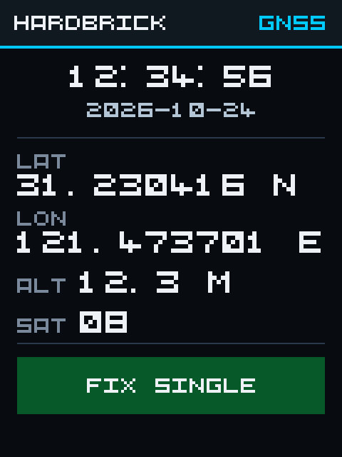
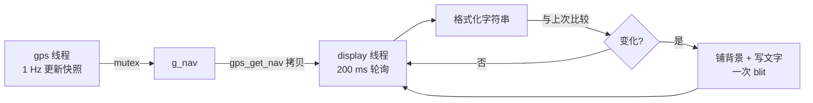

# display 应用模块设计文档

## 1. 模块概述

在 3.5" 240×320 竖屏上显示 GPS 定位信息的轻量面板。它是**短期方案**，
用最小依赖把"数据实时上屏"跑通；长期目标是用 LVGL 重做 UI，届时本模块的
布局与文字渲染会被 LVGL 替换，`BSP/ILI9341` 驱动保持不变。

**依赖**：`gps`（快照）、`ili9341`（面板）、`threadx`（线程）、`segger_rtt`（日志）。

## 2. 画面布局



> 预览图由 `docs/render_preview.py` 按同样的坐标/字模生成，仅用于版式确认；
> 实际像素以 C 代码为准。

```
+--------------------------------------+  240 x 320
| HARDBRICK                   GNSS     |  标题栏 32 px
+--------------------------------------+  青色分隔线
|              12:34:56                |  本地时间 UTC+8，3x（墨迹 15 px）
|             2026-10-24               |  日期，2x
+--------------------------------------+
| LAT                                  |  标签 2x
|  31.230416 N                         |  坐标 3x
| LON                                  |
| 121.473701 E                         |
| ALT   12.3 m        SAT   08         |  标签 2x + 数值 3x
+--------------------------------------+
|            FIX  SINGLE               |  状态条 40 px，颜色随状态变化
+--------------------------------------+
```

- 字体：`display_text.c` 内置 5×5 ASCII 点阵（MIT，来自 Brick 演示工程），
  整数倍放大 2x/3x，不做抗锯齿。**不支持中文**。
- 状态条颜色/文案：
  | 状态 | 文案 | 底色 |
  |---|---|---|
  | 还没收到过语句 | `WAITING GPS` | 深灰 |
  | 超过 10 s 没有新语句 | `GPS LOST` | 深橙 |
  | `fix=0` | `NO FIX` | 深红 |
  | `fix=1` | `FIX SINGLE` | 深绿 |
  | `fix=2` | `FIX DGPS` | 深绿 |
- 时间：GPS 输出 UTC，显示层 +8 h（含跨天/跨月/跨年处理）；日期格式 `YYYY-MM-DD`。
- 经纬度：快照里是 1e-7 度定点，显示时四舍五入到 6 位小数（约 0.1 m），
  后缀 N/S、E/W；字段为空时显示 `--`。
- 海拔：毫米定点 → 0.1 m 分辨率，例如 `12.3 m`；字段为空显示 `--`。

坐标/海拔的具体像素位置全部是 `display.c` 顶部的宏，改版式只需改这些常量。

## 3. 刷新策略



- 每个动态字段维护一份"上次字符串 + 背景色"缓存（`display_field_t`），
  字符串和底色都没变就直接跳过，静止时总线占用接近 0。
- 字段重绘是"渲染到 RGB565 大端缓冲 → 一次 `ili9341_blit()`"，不会出现
  字符逐个刷出的撕裂感。
- 线程优先级 5（GPS 解析线程为 4），每 200 ms 醒一次；单次 SPI 阻塞
  最长约 3 ms（整屏宽 3x 文字行），不会影响 1 Hz 的 GPS 解析。
- 线程栈 3072 B 静态分配，受链接器总量约束。

## 4. 文件划分

| 文件 | 职责 |
|---|---|
| `display.h` | 对外只暴露 `display_init()` |
| `display.c` | 线程、布局常量、格式化、脏字段刷新、状态条 |
| `display_text.h/.c` | 5×5 字模、整数倍缩放、RGB565 大端文本渲染 |
| `CMakeLists.txt` | target `display`，注册进 `APP_LIBS` |

## 5. 接入点

- `Core/Src/main.c` 的 USER CODE 2：`ili9341_init()` 在 `tx_kernel_enter()` 之前执行
  （约 1.3 s 初始化延时）。
- `tx_application_define()`：`gps_init()` 之后调用 `display_init()`。
- `gps_get_nav()` 内部用 `TX_MUTEX` 保护快照；GPS 线程写、显示线程读。

## 6. 已知限制 / 后续

- 无触摸：面板的 XPT2046/电阻触摸未接 ADC，本模块不处理输入。
- 无中文字库：需要中文时换 16×16 点阵或等 LVGL + 字库。
- 固定竖屏：布局按 240×320 写死；改横屏需要重排 `display.c` 的坐标宏。
- 接 LVGL 后：保留 `ili9341_init/blit`，把 `display_draw_static` 与各字段
  替换成 LVGL 的 screen/object，`display_text.c` 可整体删除。
