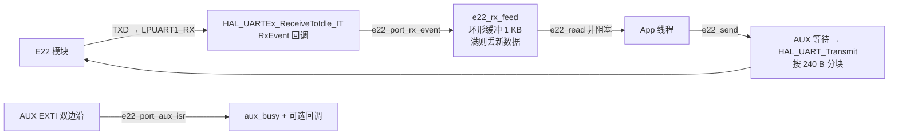

# E22-400T22S (LoRa) BSP 模块设计文档

## 1. 模块概述

本模块提供亿佰特 E22-400T22S LoRa 数传模块的底层驱动，职责限定为：

- **模式控制**：M0/M1 四模式切换（透传 / WOR / 配置 / 深度休眠）、NRST 复位；
- **数据面**：透传发送（按 240 B 分块并做 AUX 背压）、中断接收 + 环形缓冲；
- **控制面**：配置模式下用 HEX 指令读写寄存器（地址、网络、信道、空速、分包、功率等），以及 AT 查询（型号、固件版本）。

业务逻辑（组网、协议封装、业务重发策略、低功耗调度等）放在 `App/` 层，本模块不掺和。

**资料**：

- 本地手册：`C:\myProjects\资料\Lora资料\Ebyte E22-400T22S\E22-T系列模块_UserManual_CN.pdf`
  - 第五章：工作模式与 AUX 时序（重点 5.1、5.2）
  - 第六章：HEX 指令与寄存器（重点 6.1~6.3）
  - 第七章：AT 指令（型号/固件查询）

模块出厂默认（400T22S）：9600-8-N-1、透传、地址 `0x0000`、网络 `0`、信道 `0x17`
（433.125 MHz）、空速 2.4 kbps、分包 240 B、22 dBm。收发双方参数必须一致。

## 2. 硬件说明

### 2.1 接口与引脚

| 信号 | MCU 引脚 | 方向 | 说明 |
|---|---|---|---|
| LPUART1_TX | PC1 (AF8) | MCU → 模块 | 接模块 RXD（3.3 V TTL） |
| LPUART1_RX | PC0 (AF8) | 模块 → MCU | 接模块 TXD（3.3 V TTL） |
| LORA_M0 | PC6 | 输出 | 模式选择 bit0 |
| LORA_M1 | PB15 | 输出 | 模式选择 bit1 |
| LORA_NRST | PB2 | 输出 | 低电平复位，>100 us |
| LORA_AUX | PB10 | 输入/EXTI | 低=忙，高=空闲；**双边沿中断** |

- LPUART1：9600-8-N-1，无硬件流控，**时钟源 LSE 32.768 kHz**，中断接收（无 DMA）。
- `Core/Src/gpio.c` 上电把 `LORA_NRST` 初始化为低电平，即模块上电后一直处于复位态，
  必须由 `e22_init()` 释放；M0/M1 初始为低，默认透传模式。
- 模块 VCC 由 `PW_EN` 控制的电源轨供电（`main.c` 在初始化前拉高），驱动不碰 `PW_EN`。

### 2.2 9600 是硬上限

LPUART1 用 LSE 32.768 kHz 作时钟，LPUART 要求 `fck ≥ 3 × baud`，所以理论上限约
**10.9 kbps**，只有 9600 及以下可用。模块配置模式也强制 9600-8-N-1，恰好匹配。

因此 `e22_write_params()` **拒绝**把串口参数写成 9600-8-N-1 以外的值，避免模块
失联后只能拆下来用 PC 工具恢复。将来若需要 115200，必须把 LPUART1 时钟源改成
APB（同时改 CubeMX 与 `usart.c`），并同步修改该检查。

### 2.3 AUX 时序要点（手册 5.2）

| 场景 | AUX 行为 |
|---|---|
| 上电 | T1=16 ms 后可操作；T2=5 ms 后 AUX 才第一次拉低 |
| 串口收数据 | 识别到首字节约 1 ms 后拉低；缓冲接收完成（3 字节断帧）后拉高 |
| 无线发射 | 默认 `UAUX=0`，**不**指示空中发射过程；开启后发射期间保持低 |
| 模式切换 | 9~11 ms，期间 AUX 拉低 |
| 串口输出数据 | 输出前约 3 ms 拉低，可用于唤醒 MCU |

驱动把 AUX 当两件事用：

1. `e22_wait_idle()` 直接读引脚，用于发送/切模式前的背压；
2. EXTI 双边沿更新 `aux_busy` 并回调上层（可选），用于唤醒接收线程。

> AUX 上电阶段内部是上拉输入，若被外部持续拉低 1 s 以上，模块会进入固件升级
> 模式。所以 AUX 只能接 MCU 输入，不能外挂下拉或驱动负载。

## 3. 本版范围

| 维度 | v1（当前实现） | 说明 |
|---|---|---|
| 工作模式 | 四模式切换 | 数据面只实现透传发送；WOR 模式可切换、可发，但低功耗策略由 App 决定 |
| 发送 | 透传，按 240 B 分块 | 定点传输时由调用者拼「目标地址高/低 + 目标信道 + 数据」 |
| 接收 | IDLE 中断 + 1 KB 环形缓冲 | 满时丢新数据，不覆盖未消费数据 |
| 参数 | 读 0x00~0x06；写 0x00~0x06 | 另提供密钥（0x07/0x08）、WOR 应答窗口（0x09/0x0A）单独接口 |
| 查询 | AT+DEVTYPE / AT+FWCODE、PID 0x80~0x86 | 上电自检用 |
| 复位 | 软复位原语 | 运行中掉线可由 App 重新复位 |

**不在本版**：中继组网的自动转发策略、远程无线配置（`CF CF` 指令）、RSSI 数据
字节的解析（寄存器可开，字节会随数据进缓冲，由 App 处理）、固件升级。

## 4. 软件架构

### 4.1 文件划分

| 文件 | 职责 |
|---|---|
| `e22.c/.h` | 驱动核心：状态机、模式/复位/AUX 等待、环形缓冲、HEX/AT 协议。**纯 C，不 include HAL/RTOS 头文件** |
| `e22_port.c/.h` | 平台移植层：LPUART1 中断收发、M0/M1/NRST/AUX、EXTI 重配、HAL tick/delay。**唯一允许接触 HAL 的文件** |
| `CMakeLists.txt` | target `e22`，注册进 `BSP_LIBS`（`BSP/CMakeLists.txt`） |

驱动核心与移植层之间只通过 `e22_port.h` 的一组函数交互，签名不含 HAL 类型；
换 MCU/换串口只改 `e22_port.c`。

### 4.2 数据流



### 4.3 并发与依赖

- 依赖方向：`App` → `e22`（core）→ `e22_port` → HAL。core 不 include 任何 HAL 头文件。
- **接收是 SPSC**：RX 中断只写 `rx_head`，消费线程只写 `rx_tail`，不需要锁。
- **发送/配置不加锁**：`e22_send()` 只允许一个写者；配置类 API 会切模式并从同一个
  环形缓冲读响应，**不能**和 `e22_read()` 在两个线程里并发调用。建议由 App 的
  LoRa 线程独占驱动。
- `e22_init()` 在 `tx_kernel_enter()` 之前执行，内部只用 `HAL_Delay`，不依赖 RTOS。

## 5. API 契约

### 5.1 数据类型

```c
typedef struct {
  uint8_t *rx_ring;        /* 调用者分配，容量必须是 2 的幂 */
  uint16_t rx_ring_size;   /* 建议 1024 */
  e22_aux_cb_t aux_cb;     /* 可选，EXTI 上下文 */
  void *user;
} e22_cfg_t;

typedef struct e22 {
  uint8_t *rx_ring;
  uint16_t rx_ring_size;
  volatile uint16_t rx_head, rx_tail;
  volatile uint32_t rx_dropped;
  volatile bool aux_busy;
  e22_mode_t mode;
  bool ready;
  e22_aux_cb_t aux_cb;
  void *user;
} e22_t;
```

`e22_params_t` 对应寄存器 0x00~0x06：地址、网络码、信道、串口波特率/校验、空速、
分包长度、功率、RSSI 使能、软切模式、定点/中继/LBT、WOR 角色与周期。

### 5.2 接口函数

```c
/* 生命周期 */
e22_status_t e22_init(e22_t *inst, const e22_cfg_t *cfg);
e22_status_t e22_reset(e22_t *inst);
e22_status_t e22_set_mode(e22_t *inst, e22_mode_t mode, uint32_t timeout_ms);
e22_mode_t   e22_get_mode(const e22_t *inst);
bool         e22_is_busy(const e22_t *inst);
e22_status_t e22_wait_idle(e22_t *inst, uint32_t timeout_ms);

/* 数据面 */
e22_status_t e22_send(e22_t *inst, const uint8_t *data, uint16_t len, uint32_t timeout_ms);
uint16_t     e22_read(e22_t *inst, uint8_t *buf, uint16_t max_len);
uint16_t     e22_available(const e22_t *inst);
void         e22_flush_rx(e22_t *inst);

/* 控制面 */
e22_status_t e22_read_params(e22_t *inst, e22_params_t *out);
e22_status_t e22_write_params(e22_t *inst, const e22_params_t *params);
e22_status_t e22_read_pid(e22_t *inst, uint8_t pid[E22_PID_LEN]);
e22_status_t e22_read_regs(e22_t *inst, uint8_t start, uint8_t len, uint8_t *buf);
e22_status_t e22_write_regs(e22_t *inst, uint8_t start, uint8_t len, const uint8_t *buf);
e22_status_t e22_write_key(e22_t *inst, uint16_t key);
e22_status_t e22_write_wor_delay(e22_t *inst, uint16_t delay_ms);
e22_status_t e22_read_wor_delay(e22_t *inst, uint16_t *delay_ms);
e22_status_t e22_at_query(e22_t *inst, const char *cmd, const char *key,
                          char *out, uint16_t out_size, uint32_t timeout_ms);
e22_status_t e22_at_command(e22_t *inst, const char *cmd, uint32_t timeout_ms);

/* 中断入口（由 port/HAL 回调调用） */
void e22_rx_feed(e22_t *inst, const uint8_t *data, uint16_t len);
void e22_aux_event(e22_t *inst, bool busy);
```

### 5.3 使用示例

```c
static uint8_t g_lora_ring[1024];
static e22_t   g_lora;

void app_lora_init(void)
{
  e22_cfg_t cfg = {
    .rx_ring = g_lora_ring,
    .rx_ring_size = sizeof(g_lora_ring),
    .aux_cb = app_lora_aux_isr,   /* 可选；ISR 里只置事件标志 */
  };

  if (e22_init(&g_lora, &cfg) != E22_OK) {
    /* 查供电 / NRST / AUX 接线 */
  }
}

void app_lora_thread_entry(void)
{
  uint8_t buf[240];

  for (;;) {
    uint16_t n = e22_read(&g_lora, buf, sizeof(buf));
    if (n != 0u) {
      /* 处理收到的透传数据 */
    }

    if (/* 有待发数据 */) {
      (void)e22_send(&g_lora, tx, tx_len, 1000u);   /* 阻塞到字节交给模块 */
    }

    tx_thread_sleep(1);   /* 10 ms */
  }
}
```

改信道示例：

```c
e22_params_t p;
if (e22_read_params(&g_lora, &p) == E22_OK) {
  p.channel = 23;                 /* 433.125 MHz */
  (void)e22_write_params(&g_lora, &p);   /* 内部切配置模式、写入、切回透传 */
}
```

## 6. 寄存器速查（E22-400T22S）

| 地址 | 字段 | 说明 |
|---|---|---|
| 0x00/0x01 | ADDH/ADDL | 通信地址，`0xFFFF` = 广播/监听 |
| 0x02 | NETID | 网络码，同网络需一致 |
| 0x03 | REG0 | `[7:5]` 波特率、`[4:3]` 校验、`[2:0]` 空速 |
| 0x04 | REG1 | `[7:6]` 分包、`[5]` 环境 RSSI、`[2]` 软切模式、`[1:0]` 功率 |
| 0x05 | REG2 | 信道，400 频段 0~83，频率 = 410.125 + CH MHz |
| 0x06 | REG3 | `[7]` 数据 RSSI、`[6]` 定点、`[5]` 中继、`[4]` LBT、`[3]` WOR 角色、`[2:0]` WOR 周期 |
| 0x07/0x08 | CRYPT | 只写密钥 |
| 0x09/0x0A | WD | WOR 接收方应答窗口（ms） |
| 0x80~0x86 | PID | 7 字节二进制产品信息（不是 ASCII；型号用 AT+DEVTYPE 查） |

**REG0 位序容易看错**：手册 6.2 的表格把「串口波特率」画在 bit7~5 上，6.3 的详表
才给出真实位序。默认帧 `C0 00 09 00 00 00 62 00 17 03 00 00` 中 `0x62 = 011 00 010`
正好是「9600 + 8N1 + 2.4 k」，可以反推验证。

### 6.1 HEX 指令

配置模式（M1=1、M0=0）下：

| 操作 | 发送 | 应答 |
|---|---|---|
| 写寄存器 | `C0 + 起始地址 + 长度 + 参数` | `C1 + 起始地址 + 长度 + 参数`（回显） |
| 读寄存器 | `C1 + 起始地址 + 长度` | `C1 + 起始地址 + 长度 + 参数` |
| 格式错误 | — | `FF FF FF` |

驱动在 `e22_wait_hex()` 里用 3 字节滑动窗口找应答头，容忍切模式残留的零星字节；
写入后逐字节比对回显，防止「应答了但没落盘」。

## 7. 错误处理

| 场景 | 处理 |
|---|---|
| 环形缓冲满 | 丢弃新到的整段里放不下的部分，`rx_dropped` 累加；不覆盖未消费数据 |
| ORE / 帧错误 | `HAL_UART_ErrorCallback` → `e22_port_uart_error()` 复位接收并 rearm，不 panic |
| 配置应答超时 / `FF FF FF` | 返回 `E22_ERR_TIMEOUT` / `E22_ERR_PROTOCOL`，模式由 `cfg_leave` 尽力恢复 |
| AUX 一直低 | 等待超时返回 `E22_ERR_TIMEOUT`；不会死等 |
| 发送时模式不对 | `E22_ERR_STATE` |

## 8. 上电自检与验收

`main.c` 在 `tx_kernel_enter()` 之前调用 `lora_selftest()`。本板实测输出：

```
[LORA] init ok
[LORA] type=E22-400T22S fw=7453-0-23
[LORA] pid=002210160A0000
[LORA] addr=0x0000 netid=0 ch=23 (433.125MHz) air=2400 bps
[LORA] uart=9600 8N1 pkt=240 B pwr=22 dBm fixed=0 lbt=0 relay=0
[LORA] wor_role=0 period=2000 ms rssi_env=0 rssi_byte=0 soft=0
```

> `pid` 是 7 字节**二进制**产品信息（0x80~0x86），不是 ASCII 字符串，含义由厂家
> 定义；识别型号请看 `type`（AT+DEVTYPE），不要拿 `pid` 当型号字符串。

验收清单：

- [x] RTT 能看到 `init ok`，且 `type`/`fw` 与实物一致，参数为出厂默认；
- [ ] 两块模块（同信道、同空速）互相透传：A 发 B 收，`e22_read()` 能取到字节；
- [ ] 连续发送 1 KB 数据不丢包（模块 240 B 自动分包，接收端缓冲足够）；
- [ ] 改信道后 `e22_read_params()` 读回一致，重新上电仍保持（参数掉电保存）；
- [ ] 长时间运行 `rx_dropped` 不增长；人为拔天线不影响 UART 通信。

## 9. 已知限制与后续

1. **9600 上限**：见 2.2。若产品需要更高吞吐（240 B @ 9600 约 250 ms），要先换
   LPUART1 时钟源。
2. **发送是阻塞的**：`HAL_UART_Transmit` 在 240 B 时约 250 ms；建议放在独立线程，
   不要在高优先级控制环里调用。
3. **AUX 不保证空中发送完成**：默认 `UAUX=0`，AUX 只反映模块串口缓存；需要精确
   的「发射完成」时，用 `e22_at_command("AT+UAUX=1", 300)` 打开空中发射指示，
   之后 `e22_wait_idle()` 就会等空中发射结束。
4. **远程配置 / 中继 / 固件升级**未实现；中继参数可以先写进模块，但转发策略不在
   驱动里。
5. **定点传输单包上限**：定点模式数据前 3 字节是目标地址+信道，`e22_send()` 按
   240 B 分块时不会给后续块补目标头，因此定点模式下一次调用必须 <= 240 B
   （含 3 字节头），否则返回 `E22_ERR_PARAM`。驱动用最近一次
   `e22_read_params()`/`e22_write_params()` 的结果判断是否定点；上电自检读过一次，
   运行中不会失效。
6. **默认 AUX 不指示空中发射**：`UAUX=0` 时 `e22_send()` 返回只代表字节进了模块
   串口缓存；发完立刻切配置模式/复位可能打断当前空中包。需要严格时序时先
   `AT+UAUX=1`（用 `e22_at_command()` 发送），之后 `e22_wait_idle()` 会等
   空中发射结束。
7. **配置 API 与 `e22_read()` 不能并发**：驱动不加锁，由 App 保证单一所有者。
