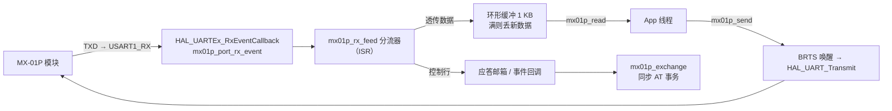

# MX-01P（BLE 5.3 透传）BSP 模块设计文档

## 1. 模块概述

本模块提供妙享科技 MX-01P 蓝牙低功耗（BLE 5.3）透传模块的底层驱动，职责限定为：

- **生命周期**：RES 硬复位 / `AT+REBOOT` 软复位 / 恢复出厂，以及手册强制的
  `+READY` 握手；
- **数据面**：透传发送（`FFF1` 通知通道）、中断接收 + 环形缓冲、
  **AT 应答与透传数据的串口分流**；
- **控制面**：手册第 5~15 页全套 AT 指令（MAC / 名称 / 广播 / 波特率 / 广播间隔 /
  版本 / 功率 / 三条 UUID / 自定义广播数据 / 设备列表 / 断开连接）；
- **功耗**：BRTS 睡眠脚控制，发送与 AT 前自动唤醒。

业务逻辑（连接管理策略、数据协议封装、低功耗调度、OTA 等）放在 `App/` 层，
本模块不掺和。

**资料**：`C:\myProjects\PCB_Proj\docs\MX-01P规格书+V0.0.5.pdf`

| 手册页 | 内容 | 本驱动的对应实现 |
|---|---|---|
| 第 3 页 | 出厂默认参数 | 见第 8 节实测表 |
| 第 4 页 | 引脚定义（CDS/LINK/FC/BRTS/RES） | 见 2.1 / 2.2 |
| 第 5 页 | 透传通道 FFF0 / FFF1 / FFF2 | 见 3.2 |
| 第 6~15 页 | AT 指令逐条格式与应答 | `mx01p_read_*` / `mx01p_write_*` |

出厂默认：**115200-8-N-1**、广播开、广播间隔 200 ms、功率 0 dBm、
服务/读/写 UUID = `FFF0/FFF1/FFF2`、名称 `NB-<MAC>`。

## 2. 硬件说明

### 2.1 接口与引脚

| 信号 | MCU 引脚 | 方向 | 说明 |
|---|---|---|---|
| USART1_TX | PA9 (AF7) | MCU → 模块 | 接模块 RXD（Pin13），3.3 V TTL |
| USART1_RX | PA10 (AF7) | 模块 → MCU | 接模块 TXD（Pin14），3.3 V TTL |
| BT_RES | PC3 | 输出 | 模块 RES（Pin16），**低电平复位** |
| BT_BRTS | PA1 | 输出 | 模块 BRTS（Pin15），**高/悬空 = 睡眠，低 = 工作** |

- USART1：115200-8-N-1，无硬件流控，中断接收（`HAL_UARTEx_ReceiveToIdle_IT`，
  与 E22/GPS 同一套写法），IRQ 优先级 10。
- `Core/Src/gpio.c` 上电把 `BT_RES` 初始化为**低电平**（模块一直处于复位态），
  必须由 `mx01p_init()` 释放；同时把 `BT_BRTS` 初始化成**低电平**（模块工作态），
  这一点很关键：BRTS 一旦悬空或拉高，模块会睡过去，`+READY` 永远等不到。
- 模块 VCC 由 `PW_EN` 控制的电源轨供电（`main.c` 在初始化前拉高），驱动不碰 PW_EN。

### 2.2 本板没有接的三根线（决定了驱动的能力边界）

| 模块脚 | 手册语义 | 本板 | 驱动后果 |
|---|---|---|---|
| CDS (IO22) | 高/悬空 = AT 命令有效，非 AT 数据透传；低 = AT 关闭 | 悬空 = 高 | **AT 指令始终有效**：以 `AT+` 开头的载荷会被模块当命令吃掉（见 10.2） |
| LINK (IO21) | 已连接输出高，未连接输出低 | 悬空 | 连接状态只能靠 `+CONNECTED`/`+DISCONNECTED` 事件与 `AT+DEV?` 跟踪 |
| FC (IO20) | 高 = 模块不允许 MCU 继续发串口数据 | 悬空 | 没有硬件背压，发送节奏由上层控制（BLE 连接间隔 30 ms） |

### 2.3 复位与上电时序

| 场景 | 处理 | 数值来源 |
|---|---|---|
| RES 低电平保持 | `MX01P_RESET_LOW_MS = 10 ms` | 手册只写"拉低复位"，无下限，取保守值 |
| 复位释放 → `+READY` | 驱动轮询等待，默认上限 3000 ms | 手册第 6 页备注"上电或重启成功…收到 +READY 后才能执行指令和数传" |
| BRTS 唤醒 → 可发送 | `MX01P_WAKE_MS = 10 ms` | 手册未给，实测 10 ms 稳定（第 8 节） |

本板实测：复位释放到 `+READY` 约 **795~827 ms**（BLE 协议栈启动耗时），
与 `ready_ms` 字段一致。

## 3. 协议要点

### 3.1 AT 与异步事件

- 命令统一 `<CMD>\r\n`（`0x0D 0x0A` 结尾）。
- 设置类回 `OK\r\n` / `ERROR\r\n`；查询类回 `+KEY:VALUE\r\n`（`+NAME: xxx`、
  `+UART: NUM` 这类带空格的，驱动统一跳空格后取值）。
- 三种异步事件，可能在任意时刻插进来：

| 事件 | 实测原文（固件 V0.0.8） | 驱动动作 |
|---|---|---|
| 上电/重启完成 | `+READY` | 置 `ready_edge`，回调 `MX01P_EVENT_READY` |
| 主机连上 | `+CONNECTED:1,A08069F43EA8` | 更新 `link_up/link_type/link_mac`，回调 |
| 连接断开 | `+DISCONNECTED:1,A08069F43EA8` | 同上，`link_up = 0` |

> **手册与实物不一致**：手册写 `+DISCONN:TYP,MAC`，实测固件发的是
> `+DISCONNECTED:`。驱动按**名字前缀**匹配（`CONNECT` / `DISCONN`），两种拼写都认，
> 冒号位置不写死。这条差异是上板联调才发现的，见 10.7。

`TYP = 1` 表示连接方为主机（手机/PC），`MAC` 为对端 12 位十六进制地址；
Windows 连 BLE 时用的是随机私有地址，与网卡本身的 MAC 不同。

### 3.2 数据流向（第 5 页 BLE 协议说明）

```
手机 --写 FFF2--> 模块 --串口 TX--> MCU       （APP 发给 MCU）
MCU --串口 RX--> 模块 --通知 FFF1--> 手机      （MCU 发给 APP）
```

即：**MCU 往串口写 = 手机收到通知；手机写 FFF2 = MCU 从串口读**。
驱动只做透传，不解析业务内容；MTU 分包由模块自己完成。

PC 实测发现模块还暴露了手册第 5 页提到的 IO 控制通道（服务 `F000`，
`F001`/`F002` 写 `01`/`00` 控制模块的 IO1/IO2 电平）。本板没把这两根 IO 引出，
驱动不提供该功能。

## 4. 本版范围

| 维度 | v1（当前实现） | 说明 |
|---|---|---|
| 复位 | RES 硬复位 + `AT+REBOOT` 软复位 + `AT+RESET` 恢复出厂 | 都要等 `+READY` |
| 发送 | 阻塞发送，单次 ≤ 512 B | 超过返回 `MX01P_ERR_PARAM`；背压靠上层 |
| 接收 | IDLE 中断 + 1 KB 环形缓冲 + 分层分流 | 满时丢新数据，不覆盖未消费数据 |
| 参数 | 手册全套 AT：MAC/名称/广播/波特率/间隔/版本/功率/三条 UUID/广播数据 | 写波特率只接受 115200（见 10.4） |
| 睡眠 | BRTS 控制 + 发送/AT 前自动唤醒 | 睡眠时模块不能发串口（手册 Pin15） |
| 自检 | `mx01p_probe()`：init + 13 项 AT + 睡眠脚 + 数据回环 + 软复位 | 结果留全局变量供 J-Link 读 |

**不在本版**：多连接管理策略、连接参数协商（连接间隔/MTU 无 AT 指令可调）、
自定义广播数据以外的广播包字段、OTA 固件升级、断线自动重连、IO1/IO2 控制。

## 5. 软件架构

### 5.1 文件划分

| 文件 | 职责 |
|---|---|
| `mx01p.c/.h` | 驱动核心：生命周期、RX 分流器、同步 AT 引擎、参数读写、睡眠、自检。**纯 C，不 include HAL/RTOS 头文件** |
| `mx01p_port.c/.h` | 平台移植层：USART1 中断收发、RES/BRTS 控制、HAL tick/delay、临界区。**唯一允许接触 HAL 的文件** |
| `CMakeLists.txt` | target `mx01p`，注册进 `BSP_LIBS`（`BSP/CMakeLists.txt`） |

驱动核心与移植层之间只通过 `mx01p_port.h` 的一组函数交互，签名不含 HAL 类型；
换 MCU/换串口只改 `mx01p_port.c`。

### 5.2 数据流



### 5.3 并发与依赖

- 依赖方向：`App` → `mx01p`（core）→ `mx01p_port` → HAL。core 不 include 任何 HAL 头文件。
- **接收是 SPSC**：RX 中断只写 `rx_head`，消费线程只写 `rx_tail`。
- **分流器与读缓冲的交接用短临界区**：`mx01p_poll()` 把"停在候选行里的尾巴"冲进
  环形缓冲时会写 `rx_head`，因此用 `mx01p_port_irq_lock()` 包住（只有几十条指令）。
- **AT 事务是同步且独占的**：`at_pending` 期间再来一条 AT 直接返回
  `MX01P_ERR_STATE`；AT 类 API 与数据类 API **不能**在两个线程里并发调用。
  建议由 App 的一个蓝牙线程独占驱动。
- `mx01p_init()/mx01p_probe()` 在主循环（`tx_kernel_enter()` 之前）执行，内部只用
  `HAL_Delay` 与轮询，不依赖 RTOS；AT 等待循环同样是 `HAL_Delay(1)` 轮询
  （与 E22 一致），不要在优先级高于调度器关键线程的地方长时间调用。

## 6. API 契约

### 6.1 数据类型

```c
typedef struct {
  uint8_t *rx_ring;          /* 调用者分配，容量必须是 2 的幂 */
  uint16_t rx_ring_size;     /* 建议 1024 */
  mx01p_event_cb_t evt_cb;   /* 可选事件回调（READY / CONNECTED / DISCONN） */
  void *user;
  uint32_t ready_timeout_ms; /* 0 = 默认 3000 ms */
} mx01p_cfg_t;

/* 事件回调：EVENT 类型 + TYP + MAC（MAC 指针仅在回调期间有效） */
typedef void (*mx01p_event_cb_t)(mx01p_t *inst, mx01p_event_t event,
                                 uint8_t link_type, const char *mac);
```

返回值统一为 `mx01p_status_t`（负值即错误）：`OK / ERR_PARAM / ERR_TIMEOUT /
ERR_IO / ERR_PROTOCOL / ERR_STATE / ERR_NOMEM`。

### 6.2 接口函数

```c
/* 生命周期 */
mx01p_status_t mx01p_init(mx01p_t *inst, const mx01p_cfg_t *cfg);
mx01p_status_t mx01p_reset(mx01p_t *inst);
mx01p_status_t mx01p_reboot(mx01p_t *inst);
mx01p_status_t mx01p_restore(mx01p_t *inst);

/* 睡眠与链路状态 */
mx01p_status_t mx01p_set_sleep(mx01p_t *inst, bool sleep);
bool  mx01p_is_asleep(const mx01p_t *inst);
bool  mx01p_is_connected(const mx01p_t *inst);
void  mx01p_get_link(const mx01p_t *inst, uint8_t *link_type, char *mac);

/* 数据面 */
mx01p_status_t mx01p_send(mx01p_t *inst, const uint8_t *data, uint16_t len, uint32_t timeout_ms);
uint16_t mx01p_read(mx01p_t *inst, uint8_t *buf, uint16_t max_len);
uint16_t mx01p_available(const mx01p_t *inst);
void     mx01p_flush_rx(mx01p_t *inst);

/* 通用 AT */
mx01p_status_t mx01p_at_query(mx01p_t *inst, const char *cmd, const char *key,
                              char *out, uint16_t out_size, uint32_t timeout_ms);
mx01p_status_t mx01p_at_exec(mx01p_t *inst, const char *cmd, uint32_t timeout_ms);

/* 参数快捷接口（超时统一 MX01P_AT_TIMEOUT_MS = 500 ms） */
mx01p_status_t mx01p_read_mac/write_mac(...);       /* AT+MAC? / AT+MAC= */
mx01p_status_t mx01p_read_name/write_name(...);     /* AT+NAME? / AT+NAME= */
mx01p_status_t mx01p_read_adv/set_adv(...);         /* AT+ADV? / AT+ADV= */
mx01p_status_t mx01p_read_baud/write_baud(...);     /* AT+UART? / AT+UART= */
mx01p_status_t mx01p_read/write_adv_interval(...);  /* AT+AINTVL */
mx01p_status_t mx01p_read_version(...);             /* AT+VER? */
mx01p_status_t mx01p_read/write_tx_power(...);      /* AT+TXPOWER */
mx01p_status_t mx01p_read/write_uuid(...);          /* AT+UUIDS/UUIDN/UUIDW */
mx01p_status_t mx01p_read/write_adv_data(...);      /* AT+AMDATA */
mx01p_status_t mx01p_disconnect(mx01p_t*, uint8_t mode); /* AT+DISCONN= */
mx01p_status_t mx01p_read_link(mx01p_t*, uint8_t *typ, char *mac); /* AT+DEV? */

/* 中断/轮询 + 自检 */
void mx01p_rx_feed(mx01p_t *inst, const uint8_t *data, uint16_t len);
void mx01p_poll(mx01p_t *inst);
bool mx01p_probe(mx01p_t *inst, const mx01p_cfg_t *cfg, mx01p_probe_t *out);
```

### 6.3 使用示例

```c
static uint8_t g_bt_rx_ring[1024];
static mx01p_t g_bt;

static void bt_evt(mx01p_t *inst, mx01p_event_t ev, uint8_t typ, const char *mac)
{
  /* ISR 上下文：只置标志 */
  if (ev == MX01P_EVENT_CONNECTED) {
    g_bt_connected = true;
  } else if (ev == MX01P_EVENT_DISCONNECTED) {
    g_bt_connected = false;
  }
}

void app_bt_init(void)
{
  mx01p_cfg_t cfg = {
    .rx_ring = g_bt_rx_ring,
    .rx_ring_size = sizeof(g_bt_rx_ring),
    .evt_cb = bt_evt,
  };

  if (mx01p_init(&g_bt, &cfg) != MX01P_OK) {
    /* 查 VCC / RES / USART1=115200 */
  }
  (void)mx01p_write_name(&g_bt, "HardBrick");   /* 立即生效 */
}

void app_bt_thread_entry(void)
{
  uint8_t buf[64];

  for (;;) {
    uint16_t n = mx01p_read(&g_bt, buf, sizeof(buf));
    if (n != 0u) {
      /* 手机写 FFF2 的数据 */
    }
    if (/* 有待发数据 */) {
      (void)mx01p_send(&g_bt, tx, tx_len, 100u);   /* 走 FFF1 通知给手机 */
    }
    tx_thread_sleep(1);   /* 10 ms */
  }
}
```

## 7. RX 分流规则（本驱动的核心设计点）

本板 CDS 悬空，所以 **AT 应答与手机透传数据在同一根 RX 线上交错出现**，
驱动按行做分流（`mx01p_rx_feed` / `mx01p_line_complete`）：

| 收到的内容 | 判定 | 去向 |
|---|---|---|
| 行首不是 `+` / `O` / `E` | 一定不是控制行 | **逐字节直接进数据缓冲**（零延迟） |
| `+READY` | 异步事件 | `ready_edge` + 回调 |
| `+CONNECT…:` / `+DISCONN…:` | 异步事件 | 更新链路状态 + 回调 |
| 其它 `+…` 行，且**有 AT 事务在等** | AT 应答 | 应答邮箱（去 CRLF） |
| 其它 `+…` 行，**空闲时** | 以 `+` 开头的二进制载荷 | 退回数据缓冲 |
| `OK` / `ERROR`，且有 AT 事务在等 | AT 应答 | 应答邮箱 |
| 候选行超过 `MX01P_RX_IDLE_FLUSH_MS`(5 ms) 没动静 | 不可能是完整控制行 | 整体退回数据缓冲 |
| 候选行超过 95 字节 | 手册最长应答也装得下 | 整体退回数据缓冲并改为直通 |

因此：普通二进制载荷零额外延迟；只有**以 `+`/`O`/`E` 开头且不含 `\n`** 的载荷
最多晚 5 ms 到达。这个代价是为了不吞掉异步事件，已在第 8 节用回环实测验证。

## 8. 实测

### 8.1 上电自检（J-Link 读 `g_bt_probe`）

`main.c` 在 `tx_kernel_enter()` 之前调用 `bt_selftest()` → `mx01p_probe()`。
结果同时写进**全局** `g_bt_probe`（刻意不加 `static`），J-Link 直接按符号读：

```
stage = 5        init_st = 0       ready_ms = 795~827   reset_retry = 0
mac = "C329B0CFB3DB"              name = "NB-C329B0CFB3DB"
version = "V0.0.8"                baud_code = 5 (115200)
adv_on = 1        interval_ms = 200      power_code = 5 (0 dBm)
uuid = FFF0 / FFF1 / FFF2
link_st = -4（无手机在旁，属预期，不计失败）
sleep_st = 0      sleep_blocked = 1  ← BRTS 睡眠脚有效
loop_st = 0       loopback = "+VER:V0.0.8\r\n"  ← 数据通路回环
reboot_st = 0     ← 软复位后重新等到 +READY
at_total = 14     at_fail = 0   rx_dropped = 0   resp_overrun = 0
```

RTT 输出形如：

```
[BT] probe=1 stage=5 init=0 ready=795 ms retry=0
[BT] mac=C329B0CFB3DB(0) name=NB-C329B0CFB3DB(0)
[BT] ver=V0.0.8(0)
[BT] uart=115200 code=5(0) adv=1(0) aintvl=200 ms(0)
[BT] txpower_code=5(0)
[BT] uuid s=FFF0 n=FFF1 w=FFF2 (0)
[BT] sleep st=0 blocked=1 wake=0
[BT] loop_st=0 len=13 text=+VER:V0.0.8
[BT] reboot_st=0
[BT] link_st=-4 connected=0 dev_mac=-
[BT] at=14 fail=0 drop=0 overrun=0
```

自检覆盖项：

- [x] `mx01p_init()` 能释放 RES 并等到 `+READY`，`ready_ms` 稳定在 0.8 s 左右；
- [x] 13 条 AT 查询全部成功：MAC / 名称 / 版本 / 波特率 / 广播 / 间隔 / 功率 / 三条 UUID / 设备列表；
- [x] `AT+UART?` 返回码值 5（115200），与 CubeMX 的 USART1 一致；
- [x] UUID 为出厂 `FFF0/FFF1/FFF2`，名称符合手册的 `NB-<MAC>` 默认规则；
- [x] BRTS 拉高后 `AT+MAC?` 无应答、拉低后恢复 → 睡眠脚方向正确；
- [x] 从数据通路发 `AT+VER?` 能把 `+VER:V0.0.8\r\n` 当载荷收回来 → 发送、分流、接收三段都通；
- [x] `AT+REBOOT=1` 后能重新等到 `+READY` 并继续查询；
- [x] 全程 `rx_dropped = 0`、`resp_overrun = 0`（分流没有丢字节、没有抢邮箱）；
- [x] 连续多次硬复位结果一致。

### 8.2 PC 蓝牙全双工实测（Windows BLE 主机）

用 PC 的 Intel 蓝牙当 BLE 主机（Python `bleak`），MCU 侧临时加一个「收到就原样回」的
回显线程，验证两端双向通路：

```
connected=True  mtu=247
[svc] 0000fff0… Vendor specific        [chr] fff1 props=read,notify
                                       [chr] fff2 props=write,write-without-response
[svc] 0000f000… Vendor specific        [chr] f001 / f002（IO 控制通道）
[write ]  11 B  b'hello-mcu-1'                    → [notify]  11 B  一致
[write ]  22 B  b'+plus-prefixed-payload'         → [notify]  22 B  一致  ← 走空闲冲刷分支
[write ]  32 B  b'\x00\x01…\x1f'（含 0x0A/0x0D）  → [notify]  32 B  一致  ← 纯二进制不被行解析破坏
[write ]  14 B  b'line1\r\nline2\r\n'             → [notify]  14 B  一致
[write ]  60 B  b'AAAA…'（60 字节）               → [notify]  60 B  一致
收到 5 帧 / 139 B，内容一致: True
```

同时用 J-Link 读驱动实例确认了事件通路：

- 连接时 `link_up=1, link_type=1, link_mac="A08069F43EA8"`（`+CONNECTED` 解析正确）；
- 断开后 `link_up=0`、`link_mac` 保留（`+DISCONNECTED` 解析正确）；
- `rx_head` 恰好等于 13（自检回环）+ 139（本次载荷）→ **没有任何控制行漏进数据缓冲**；
- `rx_dropped = 0`、`resp_overrun = 0`。

验收清单（全部通过）：

- [x] PC 能扫到 `NB-C329B0CFB3DB`，广播里带服务 `FFF0`；
- [x] 连接后 MTU 247，`FFF1` 可订阅通知、`FFF2` 可写；
- [x] PC 写 `FFF2` → MCU 的 `mx01p_read()` 收到，字节完全一致（含二进制/CRLF/长包）；
- [x] MCU `mx01p_send()` → PC 收到 `FFF1` 通知，字节完全一致；
- [x] 断连后 `mx01p_is_connected()` 归零。

> 回显线程只是联调用的临时改动，验证完已撤除；仓库里没有留下上位机测试代码。

## 9. 错误处理

| 场景 | 处理 |
|---|---|
| 环形缓冲满 | 丢弃新到的整段里放不下的部分，`rx_dropped` 累加；不覆盖未消费数据 |
| ORE / 帧错误 | `HAL_UART_ErrorCallback` → `mx01p_port_uart_error()` 复位接收并 rearm，`rx_errors` 累加 |
| AT 无应答 | 返回 `MX01P_ERR_TIMEOUT`，`at_pending` 一定被清掉（不会卡死后续命令） |
| 模块回 `ERROR` | 返回 `MX01P_ERR_PROTOCOL` |
| 应答格式不符（缺 key / 值不是数字） | `MX01P_ERR_PROTOCOL` |
| 等 `+READY` 超时 | `init/reset` 返回 `MX01P_ERR_TIMEOUT`，`ready` 保持 false，所有 AT 返回 `MX01P_ERR_STATE`；可反复 init 重试（自检里就重试一次） |
| 应答邮箱被覆盖 | `resp_overrun` 累加（说明有人在并发用驱动程序） |
| 睡眠中调用 AT 类 API | 自动唤醒后再发（`mx01p_send` 同样），不会假装成功 |

> `rx_errors` 是**计数**而不是标志：模块复位、BRTS 唤醒的瞬间各可能出一次串口错误
> （模块重启会打断正在传输的字节），属正常——本板上电自检后恰为 2，正好对应
> `init` 的 RES 复位与 `AT+REBOOT` 各一次。运行中持续增长才说明接线/波特率/电平有问题。

## 10. 已知限制与后续

1. **AT 与透传数据不能并发**：AT 事务期间收到的、以 `+` 开头的载荷会被当成候选应答，
   最坏被丢弃。App 应该"要么在配置，要么在传数据"，不要两边同时来。
2. **CDS 悬空导致 `AT+` 载荷有风险**：模块会把行首为 `AT+` 的数据当命令解析并回
   `ERROR`，驱动无法阻止。业务协议应避免让载荷以 `AT+` 开头，或后续把 CDS 接到
   GPIO 上，在传数据时拉低它（本驱动预留了这种扩展的空间，但本板没布线）。
3. **没有硬件流控**：FC 脚未接，模块无法叫停 MCU。一次 `mx01p_send()` 只要 ≤512 B
   就由 HAL 阻塞发完，整包是否真被 BLE 发出去驱动不知道；未连接时模块会静默丢弃。
4. **波特率翻车**：USART1 被 CubeMX 固定成 115200。如果模块里存的波特率被改成别的
   值（换过固件/别人用过），`+READY` 会变成乱码 → `init` 超时。
   恢复办法：把 host 波特率临时改成模块里的值，执行 `AT+UART=5`；或按手册 `AT+RESET=1`
   恢复出厂（注意：**MAC 地址改动不可恢复**）。`mx01p_write_baud()` 因此只接受
   `MX01P_BAUD_115200`。
5. **唤醒延时是经验值**：手册没给 BRTS 唤醒时间，`MX01P_WAKE_MS = 10 ms` 是实测稳定值；
   如果换固件后偶发丢首字节，先把这里加大到 20~50 ms 再查别处。
6. **`AT+DEV?` 只取第一条**：模块支持多连接时会回多行 `+DEV:`，`mx01p_read_link()`
   只取第一行；要跟踪全部连接请用事件回调。
7. **事件拼写与手册不一致**：手册写 `+CONNECTED:` / `+DISCONN:`，实测 V0.0.8 固件发
   `+CONNECTED:` / `+DISCONNECTED:`。驱动按名字前缀匹配，两种都认；如果以后换固件
   又改了拼写，改 `mx01p_line_complete()` 里的两个前缀即可（这是上板联调才暴露的坑：
   早期版本写死 `"+DISCONN:"`，导致断开事件漏判、30 字节事件文本漏进数据缓冲）。
8. **AT 等待是忙等**：`mx01p_exchange()` 用 `HAL_Delay(1)` 轮询应答，一次事务最多
   500 ms。放在独立线程里调用，不要在控制环或高优先级线程里长时间跑。
